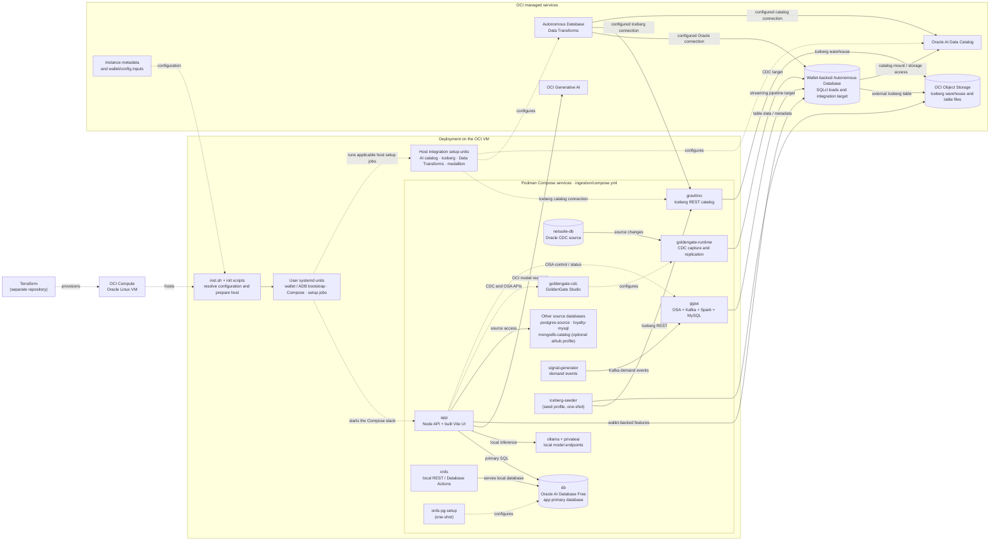

# Project architecture

## Identity

This repository packages and deploys the PeakGear AI Lakehouse LiveStack demo, including OCI/LiveLabs provisioning support, a custom VM image path, first-boot setup, and the application stack. The parent `ailakehouse` project documents the learner-facing PeakGear scenario and broader lakehouse model.

## Boundaries

- Terraform provisions OCI infrastructure in a separate repository; this repository owns the VM installer, image preparation, runtime services, and release archive.
- `inst.sh` bootstraps the VM. User systemd units coordinate Podman Compose services and follow-on setup jobs.
- The web app's primary database is the local Oracle AI Database Free Compose service. Wallet-backed Autonomous Database connectivity is a separate cloud integration used by ADB loaders and streaming/analytics workflows.
- PostgreSQL and MySQL source services are part of the standard Compose stack. MongoDB is profile-gated by the custom image's `AIHUB` choice.
- Iceberg/Gravitino, GoldenGate/OSA, Data Transforms, AI catalog, and model services connect the deployment to the lakehouse demo; consult the deployment lifecycle and data-flow notes before changing those boundaries.

## Service architecture

This diagram shows the deployment topology and the main runtime connections. The Compose service names come from [`ingestion/compose.yml`](../../ingestion/compose.yml); systemd ordering is defined by the current unit files in [`init/`](../../init/) and summarized in the [deployment lifecycle](deployment-lifecycle.md).

`mongodb-catalog` is enabled only when the `aihub` profile is selected. `iceberg-seeder` runs as a one-shot service through the `seed` profile. OCI metadata and local configuration are resolved by the host setup scripts; this picture is a topology view, not a guarantee that every optional service or setup job runs in every deployment mode.

## Business scenario

PeakGear connects shopper/product discovery and order activity with operations, data preparation, and streaming scenarios. The parent guide describes the general Bronze → Silver → Gold model; an individual walkthrough may exercise only part of that model.

## Read next

- [Deployment lifecycle](deployment-lifecycle.md) for deployment modes, configuration, and service ordering.
- [Data flow](data-flow.md) for local database versus ADB and PeakGear data paths.
- [Source map](source-map.md) to find the procedure, implementation, and tests for a change.
- [Known gaps](known-gaps.md) before relying on unresolved rationale or conflicting documentation.
- Parent scenario: [Introduction](../../../../introduction/introduction.md) and [Quickstart](../../../../quickstart/quickstart.md).
